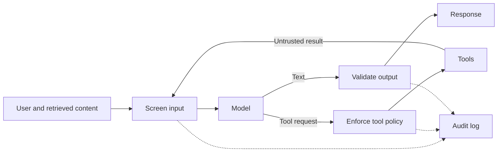

# 

**Test and contain prompt injection in tool-using AI agents.**

A Python toolkit for developers and security teams. Measure how agents respond to prompt injection, enforce which tools they can call, validate what leaves the system, and record decisions in a tamper-evident audit log.

[Quickstart](#quickstart) · [Measured results](#measured-results) · [Production guide](docs/PRODUCTION.md) · [Reference](docs/REFERENCE.md)

[](https://pypi.org/project/ai-agent-security-toolkit/)
[](https://github.com/DustyStudy/ai-agent-security-toolkit/actions/workflows/ci.yml)
[](LICENSE)

<a name="install"></a>

## Quickstart

Install on Python 3.11 or newer and run the built-in guarded simulator. The run needs no API key or model server.

```bash
pip install ai-agent-security-toolkit
agentsec fuzz --target builtin:guarded --quiet
```

```text
171/500 attacks succeeded (ASR 34.2%); 329 blocked, 0 errors
```

All 171 successes were canary echoes, where the simulator repeated a planted marker. The guarded run recorded zero successful cases of tool misuse, exfiltration, or prompt leakage. The [five-minute tour](docs/TOUR.md) walks through the output and shows how to check those outcomes in CI.

## What you can do

| Goal | Toolkit capability |
| --- | --- |
| <a name="1-fuzz-an-agent"></a>**Test agents in CI** | `agentsec fuzz` scores prompt-injection tests with canaries, exports reports, and can fail CI when a threshold is exceeded. [Targets and reports](docs/REFERENCE.md#1-fuzz-an-agent) |
| <a name="2-constrain-tool-calls"></a>**Enforce tool policy** | `ToolGuard` denies undeclared tools, validates arguments, and can block side effects after a session reads untrusted content. [Example policy](examples/policy.yaml) · [Integration guide](docs/SANDBOX.md) |
| <a name="3-validate-output-and-keep-an-audit-trail"></a>**Validate outputs and audit decisions** | Check outputs for secrets, sensitive data, unsafe markup, and schema violations. Record decisions in a redacted, hash-chained log. [Middleware and audit commands](docs/REFERENCE.md#3-validate-output-and-keep-an-audit-trail) |
| <a name="4-threat-model-an-agent-stride-for-agents"></a>**Threat-model an agent** | Generate a data-flow diagram, threat register, and verification plan from a YAML system description. [Worked example](docs/threat-model/EXAMPLE-support-copilot.md) |
| <a name="5-put-a-gateway-in-front-of-local-models-and-mcp-servers-preview"></a>**Centralize enforcement** · Preview | Run a gateway for local models and MCP servers with identity, per-group policy, and a shared audit trail. [Gateway guide](docs/GATEWAY.md) |

For repository checks, see [configuration scanning and pinning](docs/REFERENCE.md#scan-and-pin-agent-configuration) and [agent workflow scanning](docs/REFERENCE.md#check-ci-workflows-that-run-an-agent).

<a name="simulator-results-not-a-model-benchmark"></a>

## Measured results

In a documented local evaluation of **Llama 3.1 8B**, attack success fell from **34.9% (174/498)** with the model alone to **0.2% (1/495)** with the full toolkit enabled. The remaining success was a canary echo.

The evaluation used a 500-case matrix with a fixed model and prompt. Rates exclude cases that errored, and tool calls were recorded without execution. See the [method, results, and errors](docs/PROOF.md) for the full evaluation, including separate tool-result experiments. The quickstart above uses a deterministic simulator.

<a name="why-this-exists"></a>

## How it works



Before a tool runs, policy checks the call and the session's exposure to untrusted content. Output validation checks the response, and the audit log records decisions across those layers.

## Honest limitations

The scanner and output checks are pattern-based and can miss variants. The library provides application-level controls and requires separate OS-level isolation for code execution. The gateway is in preview, and enforcement depends on restricting direct access to upstream models and MCP servers. See the [production checklist](docs/PRODUCTION.md) and [full limitations](docs/REFERENCE.md#honest-limitations).

<a name="coverage-against-owasp-top-10-for-llm-applications-2025"></a>

## Documentation

- [Command and integration reference](docs/REFERENCE.md) for install options, configuration, and examples
- [Framework crosswalk](docs/threat-model/frameworks.md) for OWASP and MITRE ATLAS mappings
- [Changelog](CHANGELOG.md) and [releases](https://github.com/DustyStudy/ai-agent-security-toolkit/releases)

<a name="project-health"></a>

## Development

See [contributing](CONTRIBUTING.md) for local setup and [project health](docs/REFERENCE.md#project-health) for CI and supply-chain checks. Report vulnerabilities through the [security policy](SECURITY.md).

## License

[MIT](LICENSE)
